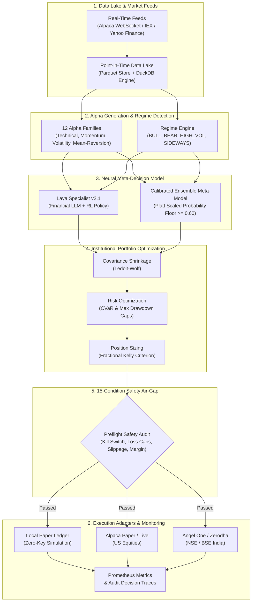

<div align="center">

# 📈 AI-Trading
### Autonomous Institutional-Grade Quantitative Trading & Research Platform

[](https://www.python.org/)
[](trading/tests)
[](trading/runtime/guards.py)
[-orange.svg)](docs/US_PAPER_LIVE_TRADING.md)
[](trading/brokers)
[](trading/storage)
[](LICENSE)

*A production-hardened quantitative research laboratory and autonomous multi-market execution engine governed by portfolio mathematics, deep risk controls, and neural intelligence.*

[Quick Start](#-quick-start-in-60-seconds) • [Architecture](#-system-architecture) • [Key Features](#-core-capabilities) • [CLI & Daemons](#-cli-reference--automation) • [Empirical Audits](#-empirical-research--audits) • [Contributing](#-contributing)

</div>

---

## 🌟 Overview

**AI-Trading** is an institutional quantitative trading platform built on a core scientific foundation:

> **"The LLM is a RESEARCH ORCHESTRATOR — not an unchecked trader."**
> Capital allocation, risk boundaries, and trade execution are strictly governed by empirical portfolio theory, Ledoit-Wolf covariance shrinkage, Conditional Value-at-Risk (CVaR), and the fractional Kelly Criterion.

Designed for both **US Equities** and **Indian Equities (NSE/BSE)**, AI-Trading defaults to **100% Free Paper-Trading** out-of-the-box — allowing users and developers to research, backtest, simulate, and monitor algorithmic strategies without requiring broker API keys or risking real capital.

---

## 🏛️ System Architecture



---

## ⚡ Core Capabilities

### 1. Dual-Market Trading Support
- **US Equities**: Full support for Alpaca Paper and Live brokerage accounts, real-time WebSocket quotes, and IEX/SIP market feeds.
- **Indian Equities (NSE/BSE)**: Seamless connectivity for Angel One SmartAPI (automated TOTP session) and Zerodha Kite Connect, alongside Yahoo Finance.
- **100% Free Paper Mode**: Runs out of the box with zero subscriptions or API keys required.

### 2. Point-in-Time Data Lake (Zero-Leakage Guarantee)
- Backed by **Apache Parquet** columnar storage and **DuckDB** analytical engine.
- Cryptographically audited causality invariants enforce zero lookahead bias: quarterly fundamentals and corporate actions are strictly invisible prior to their official `available_at` timestamp.

### 3. Institutional Portfolio Optimizer
- **Covariance Shrinkage**: Employs Ledoit-Wolf analytical shrinkage to stabilize ill-conditioned high-dimensional covariance matrices.
- **CVaR (Expected Shortfall)**: Tail-risk optimization guarding against black swan drawdowns.
- **Fractional Kelly Criterion**: Dynamically adjusts position sizing based on real win probability, payout ratios, and volatility.
- **Market Microstructure Models**: Incorporates non-linear bid-ask spread and volume-dependent square-root slippage penalties.

### 4. Laya Specialist v2.1 Neural Intelligence
- Fine-tuned domain specialist LLM with reinforcement learning (RL) meta-decision policies.
- Evaluates candidate trades across 9 financial dimensions and acts as a secondary cognitive sanity check, with cold-start fallbacks ensuring continuous operation even on CPU.

### 5. Multi-Layered Safety Air-Gap & Hardware Kill Switches
- **15-Condition Preflight Check**: Every order is verified against portfolio concentration limits, daily loss limits, maximum order size ($5,000 default), and margin capacity.
- **Emergency Kill Switch**: Hardware JSON kill switch (`trading/kill_switch.json`) instantly terminates trading loops, rejects new orders, and triggers sequential liquidation.
- **Sequential Liquidation**: Systematic, liquidity-ordered position unwinding under volatility spikes.

---

## 🚀 Quick Start in 60 Seconds

### Prerequisites
- Python 3.10, 3.11, 3.12, or 3.13
- Git

### 1. Clone & Install
```bash
git clone https://github.com/Sanvith6/AI-Trading.git
cd AI-Trading

# Create virtual environment
python -m venv .venv

# Activate virtual environment
# Windows:
.venv\Scripts\activate
# Linux/macOS:
source .venv/bin/activate

# Install dependencies
pip install -r requirements.txt
```

### 2. Configure Environment
```bash
cp .env.example .env
```
*(No API keys are required to test or paper trade! If you want AI reasoning, add your OpenRouter key, or Alpaca keys for US paper broker routing).*

### 3. Verify System Health (15/15 Preflight Checks)
```bash
# Verify that all 15 quantitative subsystems and safety gates are operational
python -m trading.cli preflight
```

### 4. Run Free Paper Backtest
```bash
# Run walk-forward backtest on any symbol (e.g., AAPL or RELIANCE.NS)
python -m trading.backtest AAPL --days 365
```

---

## 🖥️ Interactive User Interfaces

AI-Trading provides three distinct interfaces depending on your workflow:

````carousel
```bash
# 1. Streamlit Web Dashboard
streamlit run trading/trading_app.py --server.port 8502
# Or double-click: run_trading.bat
```
<!-- slide -->
```bash
# 2. Real-Time Portfolio & Market Monitor
python -m trading.cli monitor
# Or double-click: run_monitor.bat
```
<!-- slide -->
```bash
# 3. Interactive Autonomous Agent CLI
python agent_cli.py
# Or double-click: run_agent.bat
```
````

### 1. Streamlit Trading Dashboard
- Real-time technical indicator visualizers (RSI, MACD, Bollinger Bands, EMA crossovers, Volume).
- Paper portfolio ledger, order history, and P&L charts.
- Darwinian Strategy Swarm Arena for evolutionary optimization.

### 2. Live Terminal Monitor (`run_monitor.bat`)
- Real-time market clock and session state (Pre-market, Regular, After-hours).
- Real-time prices, unrealized P&L, stop-loss distance, and daily drawdown metrics.

### 3. Continuous Trading Daemon (`run_daemon.bat`)
- Background autonomous loop executing during market hours.
- Dynamic stop-loss tracking and automated portfolio rebalancing at configurable intervals.

---

## 🛠️ CLI Reference & Automation

The platform provides a unified CLI via `trading.cli`:

```bash
# Run full 15-condition startup preflight audit
python -m trading.cli preflight

# Execute a single scheduled trading cycle
python -m trading.cli run --market US

# Launch the continuous market-hours daemon
python -m trading.cli daemon --interval 300

# Launch real-time portfolio & price monitor
python -m trading.cli monitor

# Inspect current portfolio positions and cash
python -m trading.cli portfolio

# View comparative audit report (Baseline vs Laya Specialist v2)
python -m trading.cli laya-report

# Test paper broker order roundtrip (submit, query, reconcile)
python -m trading.cli test-paper

# Check or activate emergency kill switch
python -m trading.cli kill-switch --status
python -m trading.cli kill-switch --engage
```

---

## 📁 Repository Structure

```
AI-Trading/
├── .agents/                 # MCP (Model Context Protocol) configurations
├── data_lake/               # Parquet storage, DuckDB database & dataset manifests
│   ├── laya_specialist/     # Specialist benchmarks, evaluation results, configs
│   └── market_data/         # Historical point-in-time market data
├── docs/                    # In-depth architectural documentation & runbooks
│   ├── ALPACA_PAPER_SETUP.md # Alpaca paper broker integration guide
│   ├── US_PAPER_LIVE_TRADING.md # Complete US execution runbook
│   └── US_TRADING_RUNBOOK.md   # Production deployment runbook
├── reports/                 # Empirical research reports & audit logs
│   ├── FINAL_FULL_SYSTEM_AUDIT.md
│   ├── FINAL_PORTFOLIO_OPTIMIZER_AUDIT.md
│   └── LAYA_FINANCIAL_SPECIALIST_V2_REPORT.md
├── scripts/                 # Maintenance, diagnostic & recovery drill scripts
├── trading/                 # Core Quantitative & Execution Engine
│   ├── brokers/             # Alpaca, Angel One, Zerodha & Paper brokers
│   ├── execution/           # Execution adapters, safety guards & sequential liquidation
│   ├── laya_specialist/     # Neural intelligence & RL decision policy
│   ├── market/              # Market data providers (Alpaca WebSocket/REST & Yahoo)
│   ├── monitoring/          # Health reports & Prometheus metrics
│   ├── portfolio/           # Ledoit-Wolf covariance, CVaR & Kelly optimizer
│   ├── runtime/             # Orchestrator, session lifecycle & safety gates
│   ├── storage/             # ParquetStore, DuckDBStore & DatasetRegistry
│   ├── universe/            # Point-in-time dynamic universe selection
│   ├── cli.py               # Production CLI entrypoint
│   └── tests/               # 218 test verification suite
├── requirements.txt         # Production dependencies
├── LICENSE                  # MIT License
└── README.md                # Platform documentation
```

---

## 🧪 Testing & Empirical Research

AI-Trading adheres to strict quantitative verification standards. The test suite validates causality, numerical stability, risk bounds, and broker communication.

```bash
# Run all 218 tests
pytest trading/tests -v
```

```
============================= test session starts =============================
platform win32 -- Python 3.13.0, pytest-9.2.0
collected 218 items

trading\tests\test_alpaca_mcp_config.py ..............                   [  6%]
trading\tests\test_final_hardening.py ................                   [ 13%]
trading\tests\test_full_architecture.py ............                     [ 19%]
trading\tests\test_laya_integration.py .................                 [ 27%]
trading\tests\test_laya_specialist.py ...............                    [ 33%]
trading\tests\test_laya_specialist_v2.py .......                         [ 37%]
trading\tests\test_phase1_foundation.py ..............                   [ 43%]
trading\tests\test_portfolio_optimizer.py .............................. [ 57%]
..................                                                       [ 65%]
trading\tests\test_pre_monday_readiness.py ...........................   [ 77%]
trading\tests\test_us_runtime_hardening.py ..........................    [ 89%]
trading\tests\test_us_runtime_integration.py ......................      [100%]

============================ 218 passed in 41.06s =============================
```

### Key Quantitative Audits & Reports
- **[Final Full System Audit](reports/FINAL_FULL_SYSTEM_AUDIT.md)**: 32-phase adversarial stress test and execution boundary analysis.
- **[Portfolio Optimizer Audit](reports/FINAL_PORTFOLIO_OPTIMIZER_AUDIT.md)**: Ledoit-Wolf shrinkage vs empirical covariance walk-forward tests.
- **[Laya Specialist v2 Report](reports/LAYA_FINANCIAL_SPECIALIST_V2_REPORT.md)**: Neural decision attribution, edge verification, and out-of-sample Sharpe analysis.

---

## 🤝 Contributing

Contributions are welcome! Please review [CONTRIBUTING.md](CONTRIBUTING.md) for environment setup guidelines, code conventions, and testing requirements.

1. Fork the Project
2. Create your Feature Branch (`git checkout -b feat/AmazingFeature`)
3. Ensure all tests pass (`pytest trading/tests`)
4. Commit your Changes (`git commit -m 'feat: Add AmazingFeature'`)
5. Push to the Branch (`git push origin feat/AmazingFeature`)
6. Open a Pull Request

---

## 📜 Disclaimer & License

> **Risk Warning**: Quantitative trading in financial markets involves substantial risk of loss. This software is provided solely for educational, research, and paper-simulation purposes. It is NOT financial advice. Always verify strategies extensively in simulated paper environments before considering live capital.

Distributed under the **MIT License**. See [`LICENSE`](LICENSE) for details.
