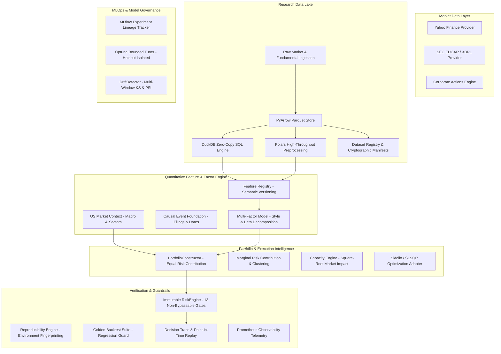

# Phase 1: Quantitative Research Foundation Upgrade — Architectural Specification

## Executive Overview
Phase 1 solidifies the quantitative research foundation of the AI Trading Platform across both US Equities (NYSE/NASDAQ) and Indian Equities (NSE/BSE). It establishes institutional-grade data correctness, cryptographic experiment lineage, point-in-time causality, and portfolio intelligence without introducing unnecessary distributed infrastructure or live broker execution risk.

---

## High-Level Architecture Diagram

---

## Key Invariants Enforced in Phase 1

1. **Zero Future Fundamental Leakage**: Financial statements are strictly gated by `available_at` (SEC public filing timestamp), never by period-end.
2. **Zero Pre-IPO / Delisted Contamination**: Point-in-time universe filters exclude instruments before their IPO date or after their delisting date.
3. **Zero Holdout Contamination**: Hyperparameter search (Optuna) is strictly bounded within training/validation folds with zero access to protected holdouts.
4. **Authoritative RiskEngine**: The portfolio construction layer cannot bypass the 13 immutable risk limits enforced by `RiskEngine`.
5. **No Speculative Complexity**: Phase 1 is built entirely using open-source in-process technologies (DuckDB, Parquet, Polars, Optuna, SciPy) without Kafka, Flink, or Kubernetes.
